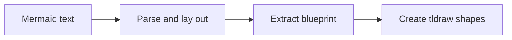

# @tldraw/mermaid

Convert [Mermaid](https://mermaid.js.org/) diagram syntax into native, editable tldraw shapes.

Instead of rendering a static SVG, `@tldraw/mermaid` parses Mermaid text and creates real geo shapes, arrows, frames, and groups on the tldraw canvas — so users can move, resize, restyle, and connect them like any other shape.

Diagrams are parsed and laid out by [pele](https://pele.run), a small Mermaid renderer, rather than the `mermaid` library. Pele reads the same syntax with its own layout, so a diagram can look different from Mermaid's rendering of it.

## Installation

```bash
npm i @tldraw/mermaid
```

**Peer dependencies:** your app must also include compatible versions of:

- **`tldraw`** — the SDK this package plugs into
- **`react`** — `^18.2.0` or `^19.2.1`
- **`react-dom`** — `^18.2.0` or `^19.2.1`

## Quick start

```tsx
import { createMermaidDiagram } from '@tldraw/mermaid'

// Inside a component or callback with access to the editor:
await createMermaidDiagram(
	editor,
	`
  flowchart TD
    A[Start] --> B{Decision}
    B -->|Yes| C[Do something]
    B -->|No| D[Do something else]
`
)
```

By default, shapes are centered on the viewport. You can control placement with `blueprintRender`:

```tsx
// Center the diagram on a specific point (default behavior)
await createMermaidDiagram(editor, diagramText, {
	blueprintRender: {
		position: { x: 500, y: 300 },
		centerOnPosition: true,
	},
})

// Place the diagram's top-left corner at the given point
await createMermaidDiagram(editor, diagramText, {
	blueprintRender: {
		position: { x: 0, y: 0 },
		centerOnPosition: false,
	},
})
```

When `centerOnPosition` is `true` (the default), the diagram's center aligns with the given position. When `false`, the diagram's top-left corner aligns with it instead. If no `position` is provided, the diagram uses the viewport center — or the cursor position if the user has "paste at cursor" mode enabled.

## Supported diagram types

| Diagram type     | Mermaid keyword      | What you get                                                               |
| ---------------- | -------------------- | -------------------------------------------------------------------------- |
| Flowchart        | `flowchart`, `graph` | Geo shapes, arrows, subgraph frames                                        |
| Sequence diagram | `sequenceDiagram`    | Actor shapes, lifelines, signal arrows, fragment frames, participant boxes |
| State diagram    | `stateDiagram-v2`    | State shapes, transitions, compound state frames, fork/join, choice        |
| Mindmap          | `mindmap`            | Colored geo shapes and text, parent-child edges, tree hierarchy            |

Unsupported diagram types (pie, gantt, class, ER, etc.) can be handled with the `onUnsupportedDiagram` callback, which receives the diagram rendered as SVG — for example, to import it as an image:

```tsx
await createMermaidDiagram(editor, text, {
	onUnsupportedDiagram(svgString) {
		editor.putExternalContent({ type: 'svg-text', text: svgString })
	},
})
```

## API

### `createMermaidDiagram(editor, text, options?)`

Parses Mermaid text, lays it out with pele, builds a blueprint from the layout, and creates tldraw shapes.

- **`editor`** — a tldraw `Editor` instance.
- **`text`** — Mermaid diagram source text.
- **`options`** — optional `MermaidDiagramOptions`:
  - `mermaidConfig` — layout settings keyed by diagram type, as in Mermaid's config (for example `flowchart.nodeSpacing`, `state.rankSpacing`). A diagram's own frontmatter config takes precedence.
  - `blueprintRender` — positioning (`position`, `centerOnPosition`) and optional `mapNodeToRenderSpec` (see below).
  - `onUnsupportedDiagram(svg)` — callback when the diagram type isn't natively supported.

Throws `MermaidDiagramError` on parse failure or unsupported diagram type (if no callback is provided).

### `renderBlueprint(editor, blueprint, opts?)`

Renders a pre-built `DiagramMermaidBlueprint` into the editor. Useful if you want to construct or modify a blueprint programmatically before rendering. Options include `mapNodeToRenderSpec` to customize how each node is materialized (see below).

### `MermaidDiagramError`

Error class with `type: 'parse' | 'unsupported'` and `diagramType` properties.

### Customizing node shapes

Blueprint nodes carry layout and semantic `kind` only. At **`renderBlueprint`** time, each node is mapped to a **`MermaidBlueprintNodeRenderSpec`**: `{ variant: 'geo', geo }` (the built-in defaults), `{ variant: 'text' }` for a bare label (the default for mindmap nodes written without brackets), or `{ variant: 'shape', type, props }` for any shape type registered on your editor.

Pass **`mapNodeToRenderSpec`** on **`blueprintRender`** (or to `renderBlueprint` directly) with a callback `(input) => spec | undefined`. **`input`** includes `diagramKind`, `nodeId`, `kind`, and the full **`node`**. Return `undefined` to keep the package default for that node. **`defaultCreateMermaidNodeFromBlueprint`** then merges the spec with layout (size, colors, label text) and calls **`editor.createShape`** once per node.

Custom `type` values must exist on the editor before import. Exotic shapes may need compatible geometry for arrow bindings to feel like built-in geo nodes.

Helpers: **`defaultMermaidNodeRenderSpec`**, **`resolveMermaidNodeRender`**, **`MERMAID_MINDMAP_NODE_TYPE`** (mindmap `kind` strings match `String` of these integers).

### Types

- **`DiagramMermaidBlueprint`** — `{ diagramKind, nodes, edges, lines?, groups? }`.
- **`MermaidBlueprintNode`** — layout, semantic `kind`, and style fields (materialization is chosen at render time).
- **`MermaidBlueprintNodeRenderSpec`** — `variant: 'geo'` + `geo`, `variant: 'text'`, or `variant: 'shape'` + `type` + `props`.
- **`MermaidDiagramKind`** — `'flowchart' | 'state' | 'sequence' | 'mindmap'`.
- **`MermaidBlueprintEdge`** — an arrow with start/end node IDs, bend, arrowheads, dash style, and anchor positions.
- **`MermaidBlueprintLineNode`** — a vertical or horizontal line (used for sequence diagram lifelines).
- **`BlueprintRenderingOptions`** — position, centering, and optional `mapNodeToRenderSpec` for `renderBlueprint` / `createMermaidDiagram`.
- **`MermaidNodeCreateFunctionArgs`** — argument object for **`defaultCreateMermaidNodeFromBlueprint`** (includes resolved **`render`** spec).

## How it works

The conversion happens in three stages:



1. **Parse and lay out** — pele parses the text into a typed model and renders it to an SVG, measuring text in tldraw's own font so boxes fit their labels. The SVG is mounted offscreen so `getBBox()` works.
2. **Extract blueprint** — a diagram-specific converter reads positions from the SVG, where every node, edge and label carries its model id, and combines them with the parsed model, producing a `DiagramMermaidBlueprint`. Each edge's bend is taken from the route pele drew for it.
3. **Create shapes** — `renderBlueprint` resolves each node’s materialization spec (mapper or default), then creates tldraw shapes (geo or custom), plus arrows, lines, frames, and groups.

## Example: paste handler

A common integration is converting Mermaid text on paste. Here's a React component that registers itself as a text content handler — based on the pattern used on [tldraw.com](https://github.com/tldraw/tldraw/blob/main/apps/dotcom/client/src/components/SneakyMermaidHandler/SneakyMermaidHandler.tsx):

```tsx
import { useEffect } from 'react'
import { defaultHandleExternalTextContent, useEditor } from 'tldraw'

const MERMAID_KEYWORD =
	/^\s*(flowchart|graph|sequenceDiagram|stateDiagram|classDiagram|erDiagram|gantt|pie|gitGraph|mindmap)/

export function MermaidPasteHandler() {
	const editor = useEditor()

	useEffect(() => {
		editor.registerExternalContentHandler('text', async (content) => {
			if (!MERMAID_KEYWORD.test(content.text)) {
				await defaultHandleExternalTextContent(editor, content)
				return
			}

			try {
				const { createMermaidDiagram } = await import('@tldraw/mermaid')
				await createMermaidDiagram(editor, content.text, {
					async onUnsupportedDiagram(svgString) {
						await editor.putExternalContent({ type: 'svg-text', text: svgString })
					},
				})
			} catch {
				await defaultHandleExternalTextContent(editor, content)
			}
		})
	}, [editor])

	return null
}
```

Drop `<MermaidPasteHandler />` inside your `<Tldraw>` component and users can paste Mermaid text directly onto the canvas.

The regex above is a simplified check. On tldraw.com the detection is handled by [`simpleMermaidStringTest`](https://github.com/tldraw/tldraw/blob/main/apps/dotcom/client/src/components/SneakyMermaidHandler/simpleMermaidStringTest.ts), which also strips YAML frontmatter (`---...---`), `%%{...}%%` directives, and `%%` comments before testing for the diagram keyword — making it more robust for real-world pasted content.

## Lazy loading

`createMermaidDiagram` loads pele on first call, and only the parser and layout for the diagram type being converted. The paste handler above also lazy-loads the package itself with `await import('@tldraw/mermaid')`, so it is only fetched when the pasted text matches a Mermaid keyword. For your own integration, the same pattern applies: pre-screen with a lightweight regex, then dynamic-import the package only when needed.

## Examples

See the [Mermaid diagrams example](https://github.com/tldraw/tldraw/tree/main/apps/examples/src/examples/use-cases/hundred-mermaids) in the examples app for a runnable demo that renders many diagram types at once. Run it locally with `pnpm dev` from the repo root and visit `localhost:5420`.

## Documentation

Documentation for the most recent release can be found on [tldraw.dev/docs](https://tldraw.dev/docs), including [reference docs](https://tldraw.dev/reference/editor/Editor). Our release notes can be found [here](https://tldraw.dev/releases).

For more agent-friendly docs, see our [LLMs.txt](https://tldraw.dev/llms.txt).

## License

This project is part of the tldraw SDK. It is provided under the [tldraw SDK license](https://github.com/tldraw/tldraw/blob/main/LICENSE.md).

## Trademarks

Copyright (c) 2024-present tldraw Inc. The tldraw name and logo are trademarks of tldraw. Please see our [trademark guidelines](https://github.com/tldraw/tldraw/blob/main/TRADEMARKS.md) for info on acceptable usage.

## Distributions

You can find tldraw on npm [here](https://www.npmjs.com/package/@tldraw/tldraw?activeTab=versions).

## Contribution

Found a bug? Please [submit an issue](https://github.com/tldraw/tldraw/issues/new).

## Community

Have questions, comments or feedback? [Join our discord](https://discord.tldraw.com/?utm_source=github&utm_medium=readme&utm_campaign=sociallink). For the latest news and release notes, visit [tldraw.dev](https://tldraw.dev).

## Contact

Find us on Twitter/X at [@tldraw](https://twitter.com/tldraw).
