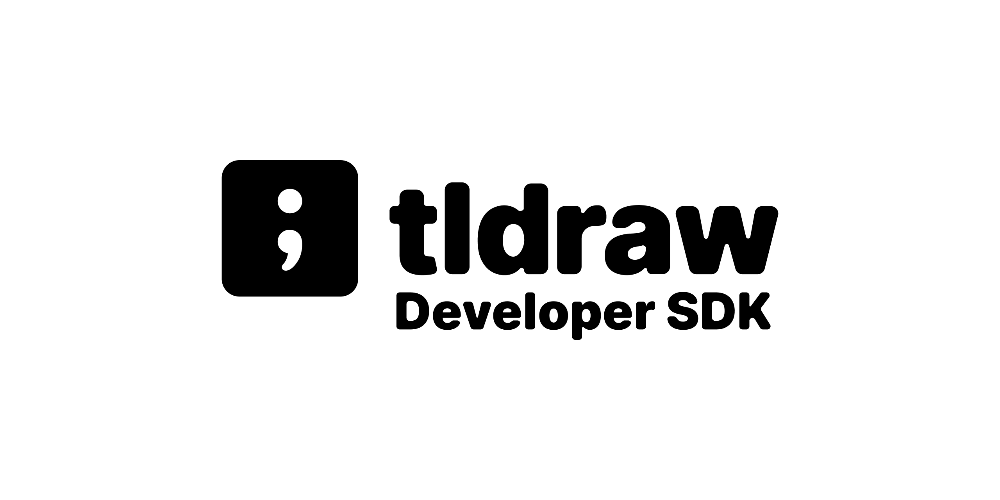

<div alt style="text-align: center; transform: scale(.5);">
	<picture>
		<source media="(prefers-color-scheme: dark)" srcset="https://raw.githubusercontent.com/tldraw/tldraw/main/assets/github-hero-dark.png" />
		
	</picture>
</div>

This repo contains a starter-kit for making an AI chat application using [tldraw](https://github.com/tldraw/tldraw).

## Local development

Install dependencies with `npm install`.

Run the development server with `npm run dev`.

Open `http://localhost:3000/` in your browser to see the app.

This starter kit demonstrates how to build an AI chat application that uses tldraw to provide sketches and annotated image to the model. The app features:

- Integrated whiteboard for providing visual context
- Image annotation and markup
- Easy switching between text chat and visual canvas input

Key interactions include:

- Chat with AI using natural language
- Click the whiteboard button to open the tldraw canvas
- Draw, sketch, and create diagrams to supplement conversations
- Annotate images and visual content directly on the canvas

## Environment setup

Create a `.env.local` file in the root directory and add a Google Gemini API key:

```
GEMINI_API_KEY=your_gemini_api_key_here
```

Get your API key from [Google AI Studio](https://aistudio.google.com/apikey).

Or use an [OpenRouter](https://openrouter.ai/settings/keys) key instead:

```
OPENROUTER_API_KEY=your_openrouter_api_key_here
```

When `GEMINI_API_KEY` is not set, requests go through OpenRouter.
The API route uses [pi-ai](https://www.npmjs.com/package/@earendil-works/pi-ai), so you can also switch to a model from another provider.

Images go to the model inside each request. Vercel limits a request body to 4.5 MB, so a chat with many large images can fail there.

## File structure

- **`src/app/page.tsx`:** The main entry point that renders the chat interface
- **`src/components/Chat.tsx`:** The main chat container, which sends messages and streams replies
- **`src/components/MessageList.tsx`:** Scrollable message history with loading states
- **`src/components/ChatMessage.tsx`:** Individual message display component
- **`src/components/ChatInput.tsx`:** Input field with send functionality
- **`src/components/WhiteboardModal.tsx`:** Modal component that integrates tldraw for drawing and sketching
- **`src/app/api/chat/route.ts`:** Next.js API route that streams replies from Gemini with pi-ai
- **`src/app/styles.css`:** CSS with responsive design for all components

## License

This project is provided under the MIT license found [here](https://github.com/tldraw/char-template/blob/main/LICENSE.md). The tldraw SDK is provided under the [tldraw license](https://github.com/tldraw/tldraw/blob/main/LICENSE.md).

## Trademarks

Copyright (c) 2024-present tldraw Inc. The tldraw name and logo are trademarks of tldraw. Please see our [trademark guidelines](https://github.com/tldraw/tldraw/blob/main/TRADEMARKS.md) for info on acceptable usage.

## Distributions

You can find tldraw on npm [here](https://www.npmjs.com/package/@tldraw/tldraw?activeTab=versions).

## Contribution

Found a bug? Please [submit an issue](https://github.com/tldraw/tldraw/issues/new).

## Community

Have questions, comments or feedback? [Join our discord](https://discord.tldraw.com/?utm_source=github&utm_medium=readme&utm_campaign=sociallink). For the latest news and release notes, visit [tldraw.dev](https://tldraw.dev).

## Contact

Find us on Twitter/X at [@tldraw](https://twitter.com/tldraw).
